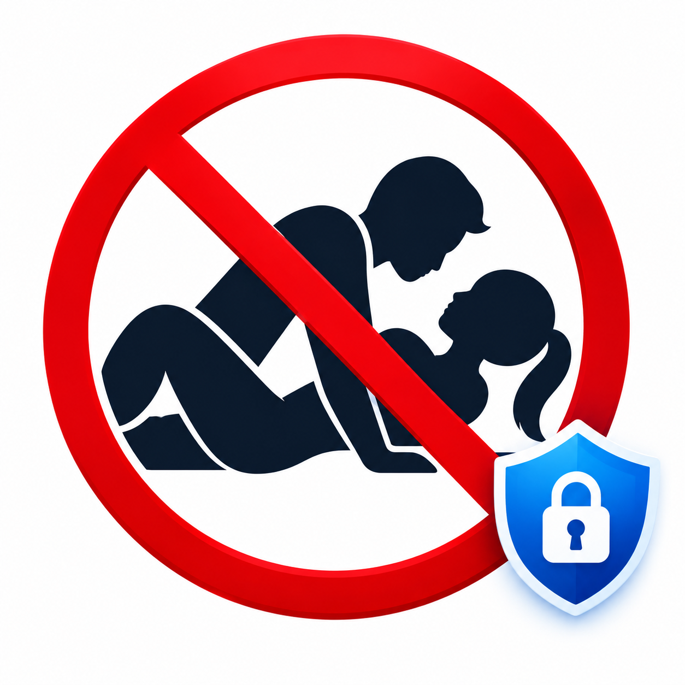

<div align="center">



# 🛡️ PureGuard

**A free browser extension that blocks adult (18+) websites, images, videos and removes ads.**


**Created by [Rongon Kairy](https://github.com/RongonKairy)**

</div>

---

<div align="center">

## 🌟 What is PureGuard?

</div>

PureGuard keeps your browsing **clean and safe**. It blocks adult websites from opening, hides adult images and videos on normal pages, turns on SafeSearch in major search engines, and removes ads and pop-ups — all **completely free**, no account needed, works fully offline inside your browser.

**You stay in control.** One big shield button switches all protection on or off, and two switches control the adult filter and the ad blocker separately.

---

<div align="center">

## 📋 Table of Contents

</div>

| # | Section |
|---|---------|
| 1 | [Features](#-features) |
| 2 | [Install](#-install) |
| 3 | [How to Use](#-how-to-use) |
| 4 | [How It Works](#-how-it-works-in-detail) |
| 5 | [Project Structure](#-project-structure) |
| 6 | [Permissions](#-permissions) |
| 7 | [Privacy](#-privacy) |
| 8 | [Limitations](#-limitations) |
| 9 | [Troubleshooting](#-troubleshooting) |
| 10 | [FAQ](#-faq) |
| 11 | [Build from Source](#-build-from-source) |
| 12 | [Updating Block Lists](#-updating-the-block-lists) |
| 13 | [Roadmap](#-roadmap) |
| 14 | [Credits](#-credits) |
| 15 | [Contributing](#-contributing) |
| 16 | [License](#-license) |

---

## ✨ Features

### 🔞 Adult Content Protection

| Feature | What it does |
|---------|-------------|
| 🚫 Adult website blocking | About **118,000** adult domains blocked. Shows a "This page was blocked" page instead. |
| 🔗 Address keyword blocking | Blocks URLs containing words like `porn`, `xxx`, `hentai`, `xvideo`, `xnxx`. |
| 🖼️ Embedded content blocking | Images, videos, scripts and frames from adult domains are blocked even on normal websites. |
| 👁️ Image and video hiding | Images/videos whose filename, alt text, title or surrounding text look adult are hidden. |
| 🏷️ Page label detection | Pages with `RTA` label or `rating: adult/mature` are blocked automatically. |
| 📝 Title & description check | Pages whose title, description or keywords contain adult terms are blocked. |
| 🔍 SafeSearch | Turns on SafeSearch for Google (`safe=active`), Bing (`adlt=strict`) and DuckDuckGo (`kp=1`). |

### 🚫 Ad Blocking

| Feature | What it does |
|---------|-------------|
| 📡 Ad network blocking | About **96,000** ad, tracker and pop-up domains blocked. |
| 🎯 Banner hiding | Google AdSense, Taboola, Outbrain and "advertisement" containers hidden. |

### 🎛️ Controls & Interface

- 🔘 One-click **on/off shield button** — toolbar icon shows `OFF` badge when off
- ⚙️ Separate switches for **Adult content** and **Ads**
- 📊 **Live status line** showing items hidden on current page
- 🔢 **Counter** of all images and videos hidden so far
- ⚠️ Clear **error message** if block lists fail to load
- ♿ Keyboard-friendly and reduced-motion support

---

## 📥 Install

Download the ZIP for your browser from the **[Releases](../../releases)** page.


| Browser | ZIP File |
|---------|---------|
| Chrome, Edge, Brave, Safari | `pureguard-chrome-edge-brave-safari.zip` |
| Firefox | `pureguard-firefox.zip` |

<p align="center">
  <a href="https://github.com/RongonKairy/PureGuard/releases/tag/v1.2.1"
     target="_blank">
    
  </a>
</p>

---

### 🟡 Chrome, Edge and Brave

1. Unzip the file into a folder
2. Open the extensions page:
   - Chrome → `chrome://extensions`
   - Edge → `edge://extensions`
   - Brave → `brave://extensions`
3. Turn on **Developer mode**
4. Click **Load unpacked** → select the unzipped folder (the one containing `manifest.json`)
5. **Refresh every tab** that is already open

> 💡 **To update:** Replace old folder files with new version → click **reload** icon on PureGuard card → refresh tabs.

---

### 🟠 Firefox

1. Unzip the Firefox file
2. Open `about:debugging#/runtime/this-firefox`
3. Click **Load Temporary Add-on** → select `manifest.json`
4. Open `about:addons` → **PureGuard** → **Permissions** → allow **Access your data for all websites**

> ⚠️ Firefox removes temporary add-ons when the browser closes. For a permanent install, the add-on must be signed on [addons.mozilla.org](https://addons.mozilla.org).

---

### 🔵 Safari (Mac only)

1. Install Xcode
2. In Terminal, run:
   ```bash
   xcrun safari-web-extension-converter /path/to/pureguard
   ```
3. Build and run the generated project in Xcode
4. Enable PureGuard in **Safari → Settings → Extensions**

---

## 🧭 How to Use

1. Click the **PureGuard icon** in the toolbar *(pin it from the puzzle-piece menu)*
2. Press the big **shield button** to turn all protection on or off
3. Use **Adult content** and **Ads** switches to control each part separately
4. Read the **This page** line:
   - `This page: 3 hidden, 12 blocked` → PureGuard is working ✅
   - `Not active on this page yet` → Reload the tab
   - `Open a website to see activity` → Appears on browser pages (new tab, etc.)

> Changes take effect **immediately** — no restart needed.

---

## ⚙️ How It Works (In Detail)

PureGuard has **four parts** that work together:

### 1. 🌐 Network Rules (`rules/*.json`)

The browser's `declarativeNetRequest` system stops blocked requests before they load.

| Rule Set | File | Contents |
|----------|------|----------|
| `adult` | `rules/adult.json` | ~118,000 adult domains + keyword URL blocking |
| `ads` | `rules/ads.json` | ~96,000 ad, tracker and pop-up domains |
| `safesearch` | `rules/safesearch.json` | SafeSearch parameters for Google, Bing, DuckDuckGo |

### 2. 📄 Content Script (`content.js`)

Runs on every page, at start of loading, in every frame.

- Checks ``, `<video>`, `<picture>` and `<iframe>` sources
- Climbs up 7 DOM levels to find and hide entire adult content cards
- Re-checks on infinite scroll, lazy loading, and after 1.5, 4 and 9 seconds
- Hidden elements get `visibility: hidden` + `data-pg-hidden` marker

### 3. 🪟 Popup (`popup.html`, `popup.css`, `popup.js`)

- Reads/writes settings
- Shows current tab status
- Shows blocked request count (Chrome-based)
- Shows errors if block lists fail

### 4. 🚫 Blocked Page (`blocked.html`)

Simple redirect page with **Go back** button shown when a site is blocked.

---

## 📁 Project Structure

```text
pureguard/
├── manifest.json                 # Chrome / Edge / Brave / Safari
├── manifest.firefox.json         # Firefox manifest
├── background.js                 # Switches rule sets on/off
├── content.js                    # Hides adult images/videos, blocks pages
├── popup.html                    # Popup layout
├── popup.css                     # Popup design
├── popup.js                      # Popup logic and status
├── blocked.html                  # Blocked website redirect page
├── blocked.css
├── blocked.js
├── assets/
│   └── logo.png                  # PureGuard logo
├── icons/
│   ├── icon16.png
│   ├── icon48.png
│   └── icon128.png
├── rules/
│   ├── adult.json                # Adult domain rules
│   ├── ads.json                  # Ad / pop-up domain rules
│   └── safesearch.json           # SafeSearch rules
└── tools/
    └── build_rules.py            # Regenerates rule files from public lists
```

---

## 🔐 Permissions

| Permission | Why it is needed |
|-----------|-----------------|
| `storage` | Saves settings and counter on your device |
| `declarativeNetRequest` | Blocks adult and ad requests |
| `declarativeNetRequestFeedback` | Shows blocked request count in popup (Chrome only) |
| `<all_urls>` | Lets content script hide adult images/ads on any website |

> ✅ PureGuard does **not** request access to your history, bookmarks, downloads or cookies.

---

## 🔒 Privacy

PureGuard does **not** collect, store or send any personal data or browsing history.

- ✅ No server
- ✅ No analytics
- ✅ No tracking
- ✅ No account required
- ✅ All checks happen **inside your browser**
- ✅ Only your settings and a counter are saved in local browser storage

---

## ⚠️ Limitations

- **Does not look at image pixels** — blocking is text-based (filenames, alt text, labels). An adult image with no adult words nearby may still appear.
- **Block lists are not perfect** — new adult/ad domains not yet on the lists won't be blocked until updated.
- **False positives can happen** — a normal page with words like "adult" or "sexy" near an image may be hidden.
- **Not a parental-control system** — anyone with browser access can switch it off. Use with OS or router parental controls for children.
- **Firefox** needs all-websites permission granted manually, and temporary add-ons disappear on restart.
- **Private/incognito windows** only work if you allow the extension in those windows.

---

## 🛠️ Troubleshooting

| Problem | Fix |
|---------|-----|
| Nothing is blocked | Refresh the tab. Check shield button says "Protection is on". |
| Popup says "Not active on this page yet" | Reload the tab |
| New version not showing after update | Click **reload** icon on extension card → refresh tabs |
| "Block lists failed to load" | Reload the extension. If it stays, open **Errors** on extensions page and report it. |
| Firefox: nothing happens | Allow **Access your data for all websites** in `about:addons` → PureGuard → Permissions |
| A normal website is blocked | Turn Adult content switch off → report the site in an Issue |
| A site looks broken | Turn Ads switch off → report the site |
| "Load unpacked" shows manifest error | Select the folder directly containing `manifest.json`, not a parent folder |
| Works in normal window, not incognito | Enable **Allow in Incognito** in extension details |

---

## ❓ FAQ

**Is it really free?**
> Yes. No paid plans, accounts or ads. Free forever.

**Does it slow down my browser?**
> Rules are handled by the browser natively and are very fast.

**Does it work on my phone?**
> Chrome for Android does not support extensions. Firefox for Android supports a limited set. PureGuard has not been tested on phones yet.

**Can I add my own sites to block?**
> Not from the popup yet. You can add domains to `EXTRA_ADULT` or `EXTRA_ADS` in `tools/build_rules.py` and rebuild.

**Can I allow one website?**
> Not yet — allow list is on the roadmap.

**Why is an image still visible?**
> PureGuard reads text, not pixels. See [Limitations](#-limitations).

**Does it block ads on YouTube?**
> Not reliably. YouTube serves ads from its own domains.

---

## 🔨 Build from Source

```bash
# Step 1 — Clone the repository
git clone https://github.com/RongonKairy/pureguard.git
cd pureguard

# Step 2 — Load as unpacked extension (see Install section)

# Firefox build:
# Copy folder → replace manifest.json with manifest.firefox.json → zip it

# Chrome build:
# Zip the folder without manifest.firefox.json
```

---

## 🔄 Updating the Block Lists

The `rules/` files are generated by `tools/build_rules.py`.

1. Download the newest lists into a `lists/` folder:

| File | Source |
|------|--------|
| `nsfw.txt` | Hagezi `wildcard/nsfw-onlydomains.txt` |
| `porn.txt` | StevenBlack `alternates/porn-only/hosts` |
| `light.txt` | Hagezi `wildcard/light-onlydomains.txt` |
| `popupads.txt` | Hagezi `wildcard/popupads-onlydomains.txt` |

2. Run the script:
```bash
python3 tools/build_rules.py lists rules
```
3. Reload the extension

---

## 🗺️ Roadmap

- [ ] ✅ Allow list ("never block this website") in popup
- [ ] 📝 Custom block list in popup
- [ ] 🔐 Optional PIN/password to prevent others switching off
- [ ] 🤖 On-device image recognition for adult images with no text clues
- [ ] 🌍 Bangla and multi-language interface
- [ ] 🏪 Published on Chrome Web Store, Edge Add-ons and Firefox Add-ons

---

## 🙏 Credits

Block lists used to generate the rules:

- [Hagezi DNS Blocklists](https://github.com/hagezi/dns-blocklists) — NSFW, Light and Pop-up Ads lists
- [StevenBlack/hosts](https://github.com/StevenBlack/hosts) — porn-only list

---

## 🤝 Contributing

Bug reports and ideas are welcome!

- **Report a problem:** Open an Issue with the website address, browser name/version, PureGuard version, and what you expected.
- **Submit a change:** Fork → make change → test as unpacked extension → open a Pull Request.

---

## 📄 License

This project is licensed under the **MIT License** — free to use, share, and modify.

```
MIT License
Copyright (c) 2026 RongonKairy
```

---

<div align="center">


**PureGuard — Browse Clean. Stay Safe. Forever Free.**

© 2026 Created by [Rongon Kairy](https://github.com/RongonKairy)

[](https://github.com/RongonKairy)

⭐ If you find PureGuard useful, please give it a **star** on GitHub!

</div>
